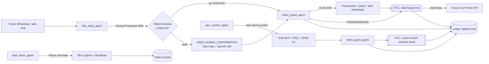
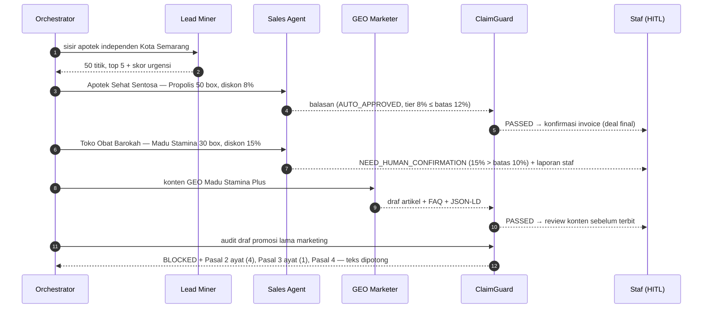

# Workflow Multi-Agent AAGE (CrewAI)

Empat agen dalam satu crew (`apps/api/src/agents_crew.py`), membaca database produk `apps/api/config/mock_products.json`
(50 produk **simulasi**). Model: `AGENT_MODEL` (default `anthropic/claude-sonnet-5-5`, lewat provider Anthropic native CrewAI).

| Agen | Peran | Tool deterministik | Output |
|---|---|---|---|
| `b2b_sales_agent` | B2B Procurement Specialist | Cari Produk, Hitung Penawaran B2B (`matriks_harga_b2b`) | Balasan WA + status `AUTO_APPROVED` / `NEED_HUMAN_CONFIRMATION` + draf laporan staf |
| `lead_miner_agent` | Data Scientist & Lead Finder | Google Places Simulator + skor urgensi | Prospek berperingkat (jarak gudang, kepadatan kompetitor jaringan ≤1 km, rating, kontak) |
| `geo_content_agent` | GEO & Medical Content Specialist | Data Teknis Produk, Kerangka Konten GEO | Artikel answer-first + FAQ + JSON-LD dengan izin edar, uji BKO, uji stabilitas |
| `claim_guard_agent` | Compliance Watchdog Hukum Farmasi | Audit Kepatuhan BPOM | `BLOCKED` / `REVIEW` / `PASSED` + pasal Perban BPOM 30/2023 + teks terpotong + notifikasi dashboard |

## Alur utama



## "Autonomous AI Workday" (tombol di Command Center)

Urutan yang dijalankan `AAGECrew.workday()` dan dialirkan sebagai log ke `/dashboard`:



## Aturan yang tidak diserahkan ke LLM

- **Harga & diskon**: selalu dari tool `Hitung Penawaran B2B`. Diskon diminta > `batas_diskon_maksimal_ai_persen` → `NEED_HUMAN_CONFIRMATION` (negosiasi otomatis berhenti). Diskon di atas tier volume tapi ≤ batas → tetap butuh staf (deal final).
- **Klaim**: audit deterministik (`kata_kunci_larangan_overclaim` produk = aturan R20, plus R01–R19) selalu dijalankan setelah agen. LLM tidak bisa menurunkan `BLOCKED`. Kalimat penafian ("tidak ditujukan untuk menyembuhkan…") dikenali sebagai negasi.
- **Invoice**: harga dihitung ulang di server dari `matriks_harga_b2b`; teks invoice diaudit ClaimGuard sebelum dikirim.

## Human-in-the-loop

`AAGECrew(human_in_the_loop=True)` (default). CrewAI menamai parameter bawaannya `Task.human_input`:

- **CLI** (`python -m src.agents_crew workday`): tugas deal final & konten memakai `human_input=True` (konfirmasi di terminal saat mode LLM).
- **API / dashboard**: item masuk tabel `approvals` (`agen_negosiasi`, `agen_deal_final`) dan tampil di halaman Approval; keputusan staf tercatat di Ledger. Baris `agen_konten` lama tetap ada, tetapi tidak dibuat lagi karena simulasi workday tidak punya draf.
- **Konten sungguhan**: `POST /api/agents/content` dan `POST /api/content/generate` memakai Studio Konten (`aage/content/studio.py`), lalu masuk Approval lewat `/submit`. `src/agents_crew.py` hanya menulis konten simulasi dari data contoh.
- **Bukti terbit**: staf mencatat kanal, alamat, dan tanggal di Studio Konten. Catatan masuk Ledger (`konten_diterbitkan`, `konten_terbit_dibatalkan`) dan alamatnya tidak dibuka sistem. Kebutuhan dari mitra untuk CMS, Search Console, dan domain ada di `docs/KEBUTUHAN_MITRA_KONTEN.md`.

## Stream log ke Next.js

`GET /api/agents/workday/stream` → Server-Sent Events, satu event JSON per aktivitas:

```json
{"agent": "claim_guard_agent", "message": "BLOCKED — 3 kalimat melanggar (…)", "level": "alert",
 "status": "BLOCKED", "clock": "09:09", "seq": 31, "data": {"audit": {"pasal_dilanggar": […]}}}
```

Dashboard `/dashboard` membaca stream ini dengan `fetch` + `ReadableStream` (header Authorization), menulis terminal, dan
menyalakan meja agen di kantor 3D sesuai field `agent`. Pada mode LLM, event internal CrewAI (agent mulai/selesai,
pemanggilan tool) ikut diteruskan lewat event bus CrewAI.

## Mode eksekusi

| `AGENT_MODE` | Perilaku |
|---|---|
| `auto` (default) | `llm` bila `ANTHROPIC_API_KEY` ada, selain itu `simulasi` |
| `llm` | CrewAI + Claude memanggil tool di atas |
| `simulasi` | Tanpa LLM: alur & tool yang sama dijalankan berurutan — untuk demo offline dan tes |

## Rujukan regulasi

`apps/api/config/regulasi_bpom.json` memetakan aturan ke **Peraturan BPOM No. 30 Tahun 2023 tentang Pedoman Klaim Khasiat
Obat Bahan Alam** (ditetapkan 3 Nov 2023). Pasal 1–8 batang tubuh sudah dicek dari teks peraturan; rincian larangan per
jenis klaim ada di **Lampiran** yang belum diverifikasi — wajib dicek dosen/tim regulasi. Perban 30/2023 berlaku untuk Obat
Bahan Alam; untuk Suplemen Kesehatan (POM SD) gunakan regulasi suplemen terkait.
